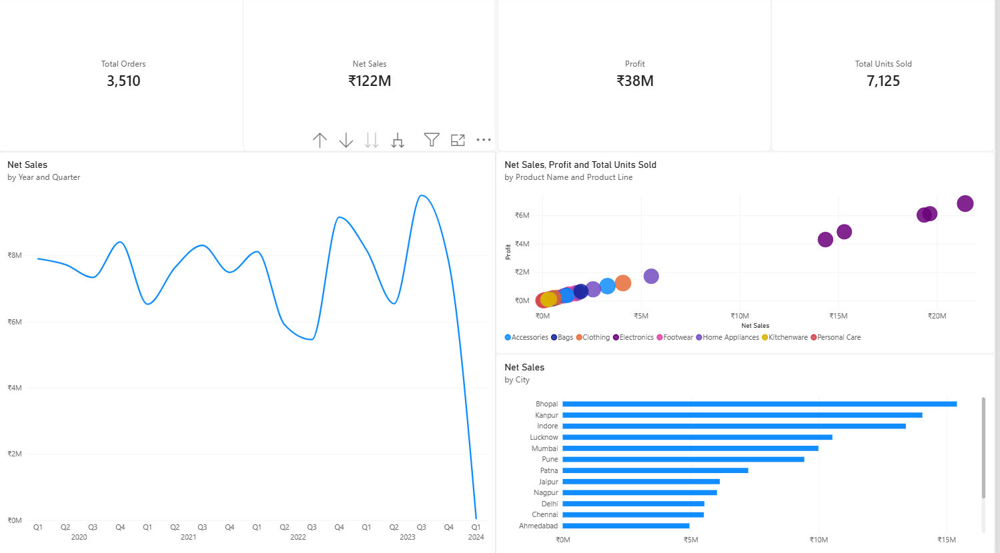
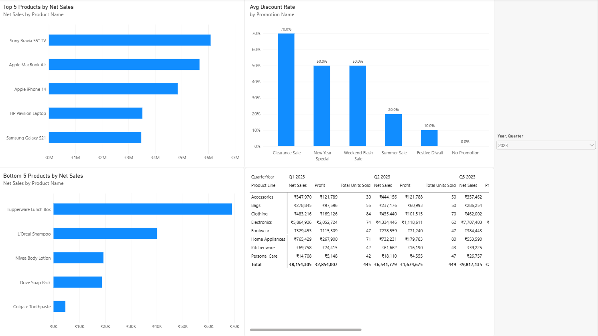
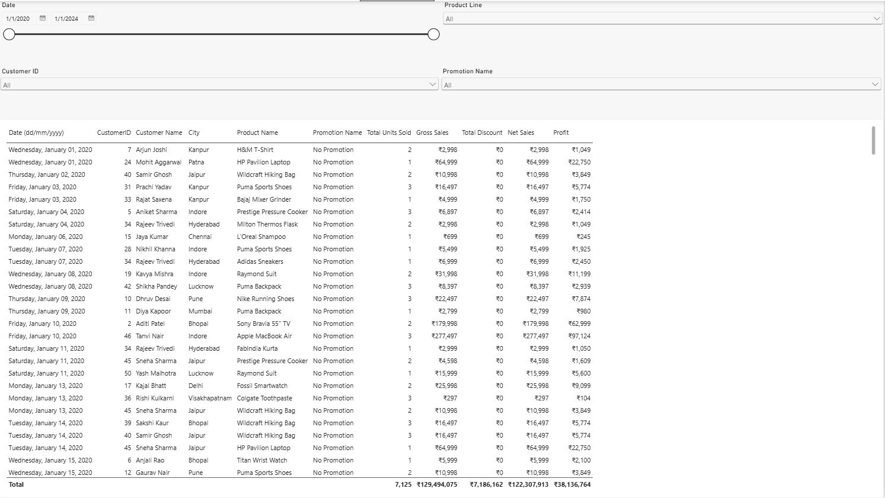

# D.A.C Datastore: Retail Sales & Performance Dashboard

An end-to-end Power BI business intelligence project evaluating 3,510 transactions across 8 product categories, customer demographics, and promotional campaigns using a star-schema relational data model.

---

## Executive Summary & Core Metrics

* **Total Orders**: 3,510 transactions
* **Total Units Sold**: 7,125 units
* **Gross Sales**: ₹129,494,075
* **Total Discounts Distributed**: ₹7,186,162
* **Net Revenue**: ₹122,307,913
* **Estimated Operating Profit**: ₹38,136,764 (Standard 35% margin baseline)

---

## Data Architecture & Modeling

The model follows a classic relational **Star Schema** centered on `FactSales`, supported by four dimensions with single-direction 1-to-many ($1:*$) relationships:

* **Fact Table (`FactSales`)**: 3,510 transaction records (`Date`, `CustomerID`, `ProductID`, `PromotionID`, `Units Sold`).
* **`Dim Customers`**: Demographic and regional data across 50 unique customers.
* **`Dim Product`**: 30 products catalogued across 8 retail categories with baseline unit prices in INR.
* **`Dim Promotion`**: 5 structured campaigns plus a normalized `0` record for standard-price transactions.
* **`DimDate`**: DAX-generated calendar table supporting hierarchical time-intelligence across Year, Quarter, Month, and Day.

---

## Business Questions Answered

### 1. Top & Bottom 5 Products
* **Top 5 by Revenue**: Sony Bravia 55" TV, Apple MacBook Air, Apple iPhone 14, HP Pavilion Laptop, and Samsung Galaxy S21.
* **Bottom 5 by Revenue**: Colgate Toothpaste, Dove Soap Pack, Nivea Body Lotion, L'Oreal Shampoo, and Tupperware Lunch Box.

### 2. Temporal Sales Trends
Evaluated through an interactive date drill-down hierarchy (`Year` → `Quarter` → `Month` → `Day`). Revenue peaked during holiday and promotional campaign quarters, with baseline volume steady across regular periods.

### 3. Sales vs. Profit Relationship
Analyzed using a scatter plot mapping Net Sales against Operating Profit across product lines. Electronics represents high revenue and margin concentration, while Personal Care and Kitchenware drive transaction frequency with lower absolute margins.

### 4. Period Comparison
Dynamic comparative matrix allowing multi-period selection across quarters and calendar years, breaking down Net Sales, Units Sold, and Profit by category side-by-side.

### 5. Promotional Discount Rates
* **Clearance Sale**: 70.0%
* **New Year Special**: 50.0%
* **Weekend Flash Sale**: 50.0%
* **Summer Sale**: 20.0%
* **Festive Diwali**: 10.0%
* **No Promotion**: 0.0%

### 6. Order Volume
Total store volume recorded at **3,510** completed transactions.

### 7. Filterable Transaction Audit
A granular transactional reporting page with dedicated interactive dropdown slicers for `Date Range`, `Product Line`, `Customer ID`, and `Promotion Campaign`.

### 8. Geographic Performance
City-level revenue distribution sorted descending, identifying **Bhopal**, **Kanpur**, and **Indore** as the leading sales territories.

---

## Dashboard Views

### Page 1: Executive Overview & Sales Trends


### Page 2: Product & Promotion Diagnostics


### Page 3: Transactional Audit & Visual Slicers


---

## Key DAX Formulas Used

```dax
// 1. Total Orders
Total Orders = COUNTROWS(FactSales)

// 2. Gross Revenue
Gross Sales = 
SUMX(
    FactSales,
    FactSales[Units Sold] * RELATED('Dim Product'[Price (INR)])
)

// 3. Discount Amount
Total Discount = 
SUMX(
    FactSales,
    FactSales[Units Sold] 
    * RELATED('Dim Product'[Price (INR)]) 
    * RELATED('Dim Promotion'[DiscountRate])
)

// 4. Net Sales
Net Sales = [Gross Sales] - [Total Discount]

// 5. Operating Profit (Cost derived at 65% base price)
Profit = 
[Net Sales] - SUMX(FactSales, FactSales[Units Sold] * (RELATED('Dim Product'[Price (INR)]) * 0.65))